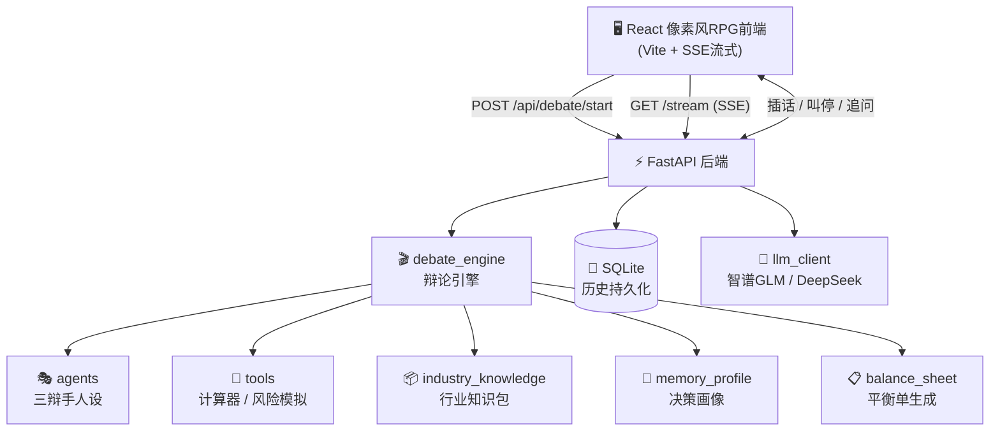

<div align="center">

# ⚔️ 三方辩论决策陪练

### 让三个 AI Agent 替你把决策辩清楚

**务实派** × **理想派** × **风险派** 三方交锋 · 你随时插话 · 生成决策平衡单

<br>


<br>

做选择时最大的痛点不是缺信息，而是**只听到一个声音**。

本项目把「决策」变成一场多方辩论：三个立场鲜明的 AI 辩手围绕你的真实问题展开多轮交锋，
用工具算账、做蒙特卡洛风险推演、引用行业常识，最后汇总成结构化的决策平衡单——
**帮你理清思路，而非替你做决定。**

</div>

<br>

---

## 🎭 三位辩手

<table>
<tr>
<td width="33%" align="center">

### 📊 老陈 · 务实派
**40岁 · 资深HR顾问**

用数据和现实逻辑说话，
擅长算账——回本周期、
机会成本、性价比。

> 「钱从哪来？谁来兜底？」

🔧 必备工具：`calculator`

</td>
<td width="33%" align="center">

### 🌱 小林 · 理想派
**28岁 · 连续创业者**

热爱驱动，看重长远成长
与人生可能性，说话像在
点燃人而不是说教。

> 「人只活一次，不能只算经济账。」

🔧 必备工具：`risk_simulate`

</td>
<td width="33%" align="center">

### 🛡️ 赵姐 · 风险派
**45岁 · 保险精算师**

先算最坏账、设计退路、
对冲不确定性，专治
幸存者偏差和盲目乐观。

> 「先活下去，再谈活得好。」

🔧 必备工具：`risk_simulate`

</td>
</tr>
</table>

---

## ✨ 核心特性

### 🎬 导演 Agent —— 每场辩论都不一样
每场辩论由独立的导演 Agent 自主规划焦点、轮次与发言顺序，不套固定模板。
辩题是「该不该裸辞」，导演就聚焦退路设计；辩题是「要不要出海」，导演就围绕合规与汇率展开。

### 🥊 钢铁人反驳 —— 拒绝各说各话
每轮辩手**必须回应对手的具体观点**，点名引用，要么用新数据深化旧观点，
要么反驳对手新观点，要么提出全新角度——严禁复读机。

### 🛡️ 三级立场自检 —— 防止立场漂移
```
关键词检测  →  LLM 语义校验  →  强化重试
   (快)           (准)           (兜底)
```
辩手立场跑偏时自动检测并纠偏，确保老陈不突然变理想主义。

### 🔧 Agent 工具调用 —— 数字有据可查
| 工具 | 能力 | 谁在用 |
|:---:|------|:---:|
| 🧮 `calculator` | 精确计算薪资差、回本周期、复利等数字账 | 老陈 |
| 📅 `get_current_date` | 获取当前日期，算时间节点、年龄、年限 | 全员 |
| 🎲 `risk_simulate` | 蒙特卡洛模拟，推演成功/失败概率与最坏情况 | 赵姐 |

> ⚡ 辩手涉及精确数字时**必须先调用工具再引用结果**，禁止凭空编造。

### 📦 行业知识包 —— 换辩题即换行业
自动识别辩题领域（**出海 / 制造 / 金融 / 教育 / 医疗 / 消费 / 职场**），
注入该行业的核心决策维度、常识量级、专业术语和常见陷阱。
LLM 识别 + 关键词兜底双保险，辩出海就聊关税汇率，辩职场就聊跳槽窗口期。

### 🧠 跨会话长期记忆 —— 越辩越懂你
辩论结束后自动提取你的决策画像（风格倾向、关注维度、历史决策），
下一场辩论注入画像上下文。你上次纠结过风险，这次赵姐会先开口。

### 📋 决策平衡单 —— 辩论的终点是行动
- **VS 对战板**：两个核心选项按 5 个维度逐项对比
- **五维雷达图** + **综合倾向罗盘**：可视化双方得分
- **条件化建议**：「如果……那么倾向……」+ 2~3 个立刻可执行的验证动作
- **追问模式**：对平衡单继续提问，结论实时更新

---

## 🏗️ 技术架构



<details>
<summary>📐 后端模块职责一览</summary>

| 模块 | 职责 |
|------|------|
| `debate_engine.py` | 辩论引擎核心：导演规划、轮次调度、工具规划器、上下文滚动摘要 |
| `agents.py` | 三个辩手人设定义与立场约束 |
| `tools.py` | Agent 工具集：calculator / risk_simulate / get_current_date |
| `industry_knowledge.py` | 8 领域行业知识包：识别 + 注入 |
| `memory_profile.py` | 用户决策画像：提取 / 注入 / 跨会话记忆 |
| `balance_sheet.py` | 决策平衡单生成与追问更新 |
| `storage.py` | SQLite 持久化：辩论历史重启可查 |
| `llm_client.py` | LLM 客户端：指数退避重试 + 优雅降级 |
| `main.py` | FastAPI 入口：HTTP / SSE 接口 |

</details>

---

## 🚀 快速开始

### 环境要求


<br>

**① 启动后端**

```bash
cd backend
copy .env.example .env        # Windows（Mac/Linux 用 cp）
# ✏️ 编辑 .env，填入你的 LLM API key
pip install -r requirements.txt
uvicorn main:app --reload     # 运行在 http://localhost:8000
```

<details>
<summary>⚙️ .env 配置示例（点击展开各模型配置）</summary>

```bash
# ===== 智谱GLM（推荐）=====
LLM_API_KEY=your-api-key
LLM_BASE_URL=https://open.bigmodel.cn/api/paas/v4
LLM_MODEL=glm-4-flash

# ===== DeepSeek =====
# LLM_BASE_URL=https://api.deepseek.com/v1
# LLM_MODEL=deepseek-chat

# ===== 通义千问 =====
# LLM_BASE_URL=https://dashscope.aliyuncs.com/compatible-mode/v1
# LLM_MODEL=qwen-plus

# ===== Kimi =====
# LLM_BASE_URL=https://api.moonshot.cn/v1
# LLM_MODEL=moonshot-v1-8k
```

</details>

<br>

**② 启动前端**

```bash
cd frontend
npm install
npm run dev                   # 打开 http://localhost:5173
```

**③ 开始辩论** —— 输入你的真实决策问题，看三位辩手为你交锋 🎉

---

## 🗂️ 项目结构

```
Three_agent/
├── backend/
│   ├── main.py                  ⚡ FastAPI 入口（HTTP/SSE）
│   ├── debate_engine.py         🎬 辩论引擎核心
│   ├── agents.py                🎭 三辩手人设
│   ├── tools.py                 🔧 Agent 工具集
│   ├── industry_knowledge.py    📦 行业知识包
│   ├── memory_profile.py        🧠 决策画像
│   ├── balance_sheet.py         📋 平衡单生成
│   ├── storage.py               💾 SQLite 持久化
│   ├── llm_client.py            🤖 LLM 客户端
│   └── models.py                📝 请求模型
├── frontend/
│   └── src/
│       ├── App.jsx                  🧭 页面路由
│       ├── index.css                🎨 像素风RPG设计系统
│       └── components/
│           ├── QuestionInput.jsx    ⌨️  输入页
│           ├── DebateArena.jsx      💬 辩论页（SSE流）
│           ├── DebateScene.jsx      🏠 像素房间场景
│           ├── BalanceSheetView.jsx ⚖️ 平衡单（雷达图+追问）
│           └── HistoryList.jsx      📜 历史辩论
└── README.md
```

---

## 🔌 API 接口

| 方法 | 路径 | 说明 |
|:---:|------|------|
| `GET` | `/api/agents` | 获取三辩手信息 |
| `POST` | `/api/debate/start` | 提出辩题，开始辩论 |
| `GET` | `/api/debate/{id}/stream` | SSE 实时流（逐 token 发言） |
| `POST` | `/api/debate/{id}/interject` | 用户插话 |
| `POST` | `/api/debate/{id}/conclude` | 叫停辩论 |
| `GET` | `/api/debate/{id}/state` | 查询辩论状态与历史 |
| `GET` | `/api/debates` | 历史辩论列表 |
| `POST` | `/api/debate/{id}/balance-sheet` | 生成决策平衡单 |
| `POST` | `/api/debate/{id}/balance-sheet/followup` | 平衡单追问 |
| `GET` | `/api/profile` | 用户决策画像 |

---

## 🛡️ 演示安全设计

- 🔄 **指数退避重试**：LLM 调用失败自动重试（1s→2s），全失败降级非流式分段产出
- 🌊 **流中断保护**：SSE 流中断保留已产出内容，优雅结束，辩论不卡死
- 💾 **持久化恢复**：历史辩论 SQLite 存储，后端重启后仍可回看与生成平衡单
- 🔗 **断线重连**：SSE 断线自动提示重连
- 🎯 **字数硬截断**：发言 230 字流式截断，防止长篇大论

---

<div align="center">

**决策不是非黑即白，而是把每一面都看清楚。**

⚔️ 三方辩论决策陪练 · 让 AI Agent 赋能你的每一个选择

</div>